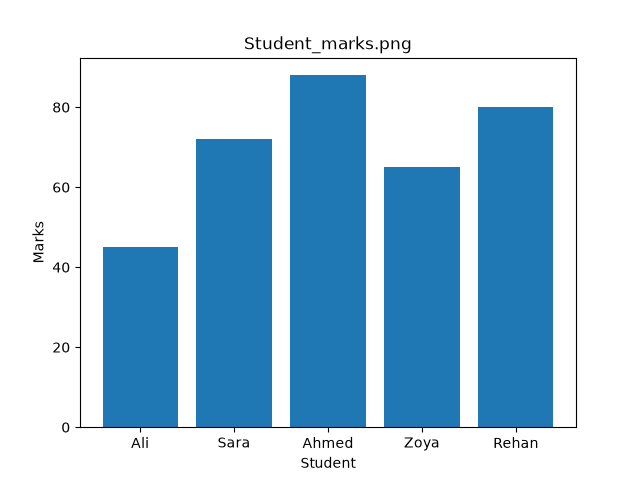

# Student Performance Analysis

A beginner data analysis project using Python, Pandas, and Matplotlib to analyze student performance.

## Project Objective

The objective of this project is to analyze student data and understand the relationship between study hours and marks.

## Technologies Used

- Python
- Pandas
- Matplotlib

## Dataset

The dataset contains:
- Student names
- Study hours
- Attendance
- Marks

## Analysis Performed

- Created and analyzed a Pandas DataFrame
- Calculated average student marks
- Compared student marks using a bar chart
- Analyzed the relationship between study hours and marks using a scatter plot

## Visualizations

### Student Marks

### Study Hours vs Marks

## Conclusion

In this small dataset, students who studied more hours generally had higher marks, showing a positive relationship between study hours and marks.

## Author

Syed Muzzammil
